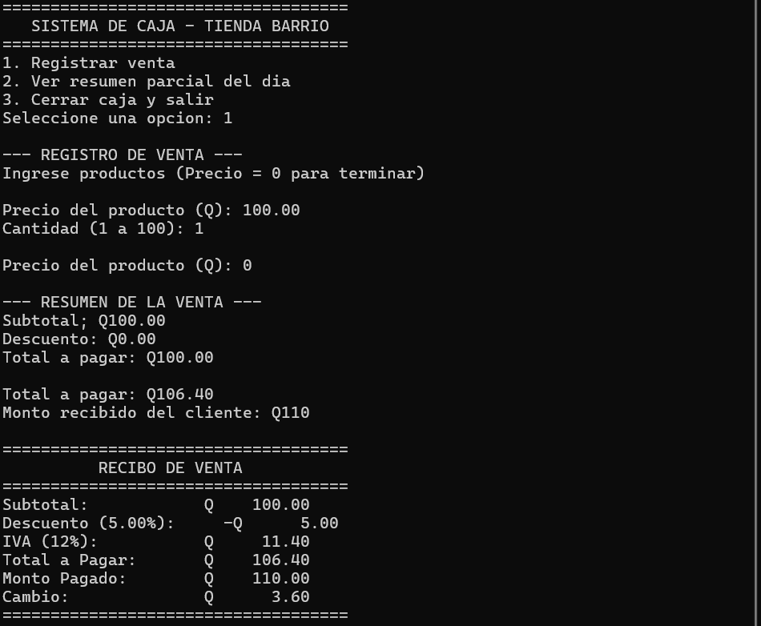
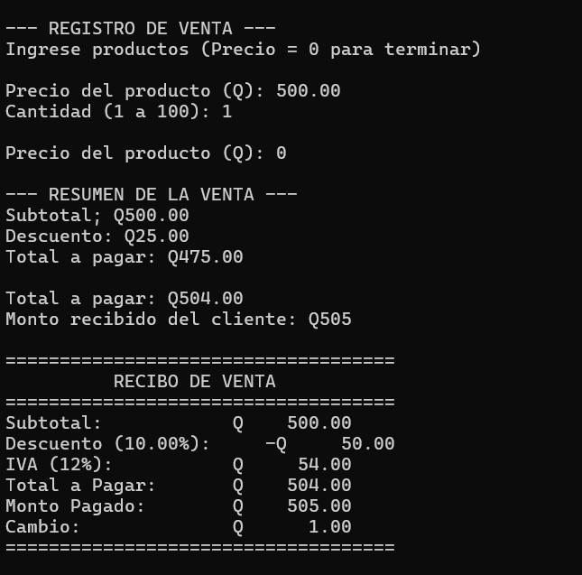
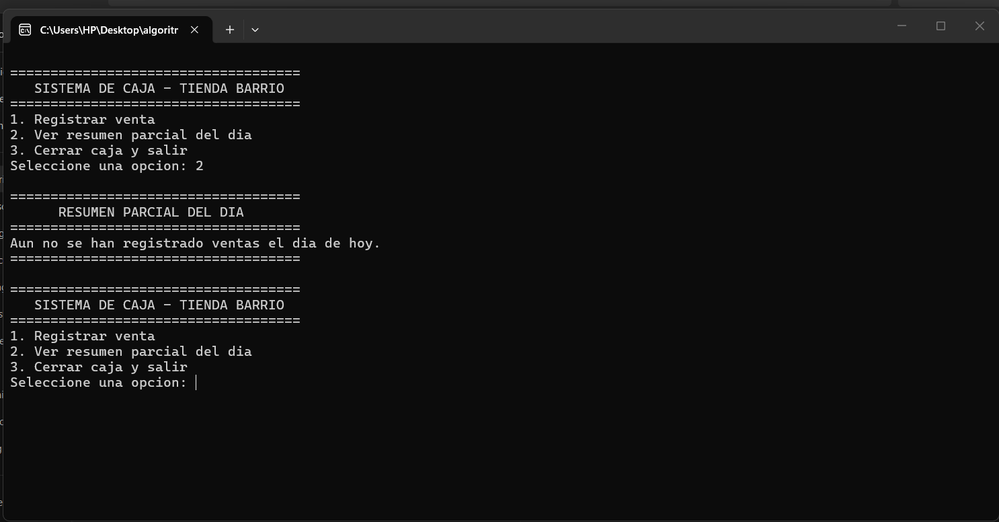

# cpp-equipo3-
# Sistema de Caja - Tienda Barrio

## Descripción
Este programa es un sistema de gestión de caja desarrollado en C++ para la automatización de ventas en tiendas locales. Permite registrar ventas individuales con múltiples productos, aplicar descuentos por tramos de compra, calcular el IVA (12%), validar pagos del cliente y emitir un recibo desglosado. Además, lleva un registro parcial del día con métricas como venta mayor, venta menor, promedio de ventas y total descontado.

---

## Lenguaje y Herramientas Utilizadas
* **Lenguaje:** C++ (C++11 o superior)
* **Compilador:** GCC / MinGW (`g++`) o MSVC (`cl`)
* **Entorno de desarrollo:** Visual Studio Code

---

## Cómo Compilar y Ejecutar

### Prerrequisitos
Tener instalado un compilador de C++ (como MinGW en Windows) y VS Code.

### Pasos de Ejecución
1. Abre la terminal en la carpeta del proyecto.
2. Compila el archivo ejecutable con el siguiente comando:
   ```bash
   g++ main.cpp -o main.exe
   ```
3. Ejecuta el programa:
   * En Windows:
     ```cmd
     .\main.exe
     ```
   * En Linux/Mac:
     ```bash
     ./main.exe
     ```

---

## Capturas de Pantalla de Ejecución

### 1. Menú Principal y Registro de Venta Normal


### 2. Menú Principal y Registro


### 3. Menú Principal y Registro


### 3. Resumen Parcial del Día y Cierre


## Video de demostración

[Ver video de demostración en Google Drive](https://drive.google.com/file/d/1iexPyk81ZgXPkZm7pj1eUQodSCrK5QvL/view?usp=drive_link)